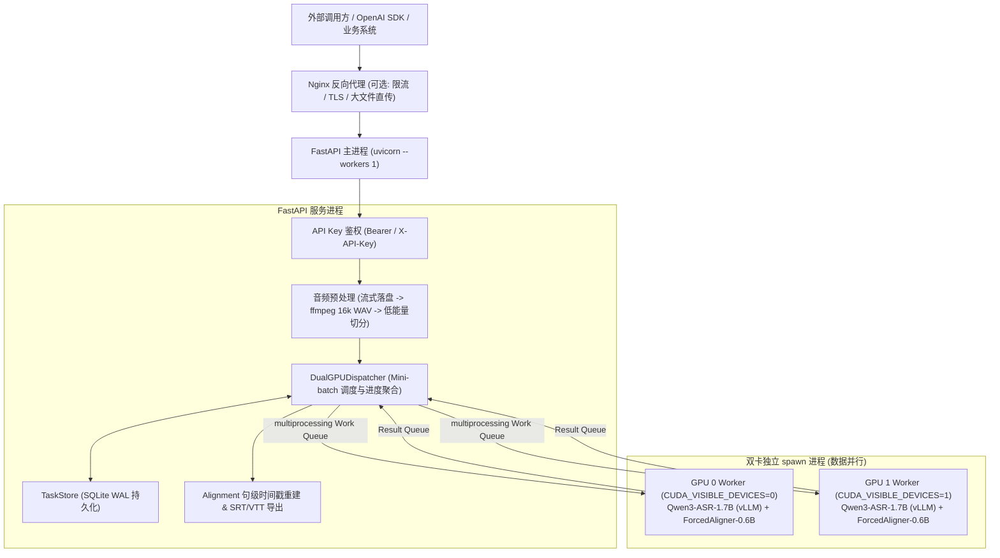

# 系统架构设计

本文档说明服务如何围绕 **双路 RTX 4090 数据并行**、**超长录音低内存流式处理** 与 **双粒度时间戳重建** 进行架构设计。

---

## 1. 整体架构



---

## 2. 为什么选择“双卡数据并行”而不是 Tensor Parallelism (TP=2)？

`Qwen3-ASR-1.7B` 参数量仅 1.7B（BF16 权重约 3.4GB），`Qwen3-ForcedAligner-0.6B` 约 1.2GB，单张 RTX 4090（24GB）即可非常从容地同时容纳两个模型并留出充足 KV Cache。

- 若强行使用 `TP=2`：跨 PCIe 卡间 AllReduce 通信开销反而会抵消小模型的计算收益，且 ForcedAligner 无法直接共享 TP 切分。
- 采用 **数据并行（每卡 1 个独立 `spawn` 进程）**：
  - **无跨卡通信开销**：每张 4090 独立运行完整的 vLLM + ForcedAligner 实例；
  - **单段长录音近 2× 加速**：一段 2 小时录音切成约 60 片后，按 `CHUNKS_PER_DISPATCH=4` 拆成 15 个小批次投入共享工作队列，GPU 0 与 GPU 1 并发抢占执行；
  - **多路并发自动均衡**：多个用户同时提交任务时，短音频批次也能快速插入空闲 GPU，不因某个长任务独占单卡而饿死。

---

## 3. 长录音防 OOM 全链路设计

处理数小时音视频文件时，如果在主进程将整段 PCM 读入内存或通过 IPC 队列传输音频数组，极易导致内存飙升和序列化的性能瓶颈。本服务采用 **纯磁盘路径传递 + 局部 Seek 读取**：

1. **流式上传落盘**（`app/audio.py: save_upload_file`）：按 1MB 分块异步写入临时目录，实时校验是否超过 `MAX_UPLOAD_SIZE_MB`，超限立即中止并清理文件。
2. **统一转码**（`app/audio.py: decode_to_wav_16k`）：调用 `ffmpeg` 将任意音视频格式（mp3/m4a/mp4/flac/ogg/amr/webm 等）转为 16kHz 单声道 PCM16 WAV，并通过 `soundfile.info` O(1) 读取精准时长。
3. **低能量静音边界切分**（`app/audio.py: compute_low_energy_chunks`）：
   - 目标片长 `CHUNK_TARGET_SEC=120s`（严格低于 `Qwen3-ForcedAligner` 的 180s 上限）；
   - 仅在每个目标切分点前后 `±CHUNK_SEARCH_EXPAND_SEC`（默认 ±5s）的小窗口内 Seek 读取 WAV 计算滑动 RMS 能量，找到能量最低点作为边界，避免从词语中间截断；
   - 保证所有切片帧范围严格连续（无重叠、无遗漏）。
4. **零拷贝 IPC 派发**：`DualGPUDispatcher` 仅向 `work_queue` 发送 WAV 路径和切片的 `(start_frame, end_frame)` 元数据；各 GPU Worker 收到任务后直接按帧范围读取对应片段波形（过短尾片自动零填充至 0.5s 避免模型报错）。
5. **自动清理**：无论同步还是异步任务，均在 `finally` 中删除原始上传文件与 16k 临时 WAV。

---

## 4. 双粒度时间戳与容错降级机制

`app/alignment.py` 与 `app/worker.py` 协同输出两层时间戳：

1. **字/词级时间戳（`words`）**：由 `Qwen3-ForcedAligner-0.6B` 对切片文本做强制对齐，并叠加该切片的 `start_sec` 偏移量转换为全局时间轴。
2. **句/子句级时间戳（`segments`）**：`build_segments_from_chunk` 将带标点的 ASR 识别原文与无标点的 `words` 序列做字符级游标匹配：
   - 遇到中英文句末标点（`。！？!?` 以及非小数点场景下的 `.`）切分新句；
   - 遇到较长停顿（默认 `> 1.2s`）或单句过长时在逗号/词边界自然断句，便于直接生成可读性高的字幕；
   - 同步输出每句包含的 `words` 子列表（当 `include_words=true` 时）。
3. **单片容错降级**：在推理 Worker 内部，先批量完成 ASR 转写，再仅对满足条件（非空、含可对齐字符、属于 ForcedAligner 支持的 11 种语种）的切片执行对齐；若对齐失败，自动回退到切片起止时间，不影响其它切片。

---

## 5. 目录结构

```text
.
├── app/
│   ├── __init__.py
│   ├── alignment.py       # 句级时间戳重建、语种合并、SRT/VTT 格式化
│   ├── audio.py           # 流式上传、ffmpeg 16k 转码、低能量切分、按帧读取
│   ├── auth.py            # Bearer / X-API-Key 常量时间比对鉴权
│   ├── config.py          # Pydantic Settings 环境变量配置
│   ├── dispatcher.py      # 双卡 Worker 生命周期管理、Mini-batch 调度、Webhook 回调
│   ├── main.py            # FastAPI 路由、SSRF 校验、OpenAI 兼容层
│   ├── schemas.py         # 请求/响应 Pydantic 模型与 verbose_json 转换
│   ├── store.py           # SQLite WAL 任务持久化与过期清理
│   └── worker.py          # 单卡独立进程推理（vLLM / Transformers / Mock）
├── deploy/
│   └── nginx.conf         # 大文件流式上传、限流与 HTTPS 反向代理模板
├── docs/
│   ├── API.md             # 完整 HTTP API 文档
│   ├── ARCHITECTURE.md    # 架构与原理说明（本文档）
│   └── DEPLOYMENT.md      # 部署、调优与运维手册
├── scripts/
│   ├── download_models.py # ModelScope / HuggingFace 模型权重下载脚本
│   └── test_client.py     # 异步/同步 API 调用与字幕导出示例客户端
├── tests/
│   ├── test_api_integration.py    # 双 Mock Worker 端到端集成测试
│   └── test_audio_and_alignment.py # 切分、对齐、字幕单元测试
├── .env.example           # 环境变量配置模板
├── .gitignore
├── Dockerfile
├── docker-compose.yml
├── pyproject.toml
├── requirements.txt
├── requirements-dev.txt
└── README.md
```
