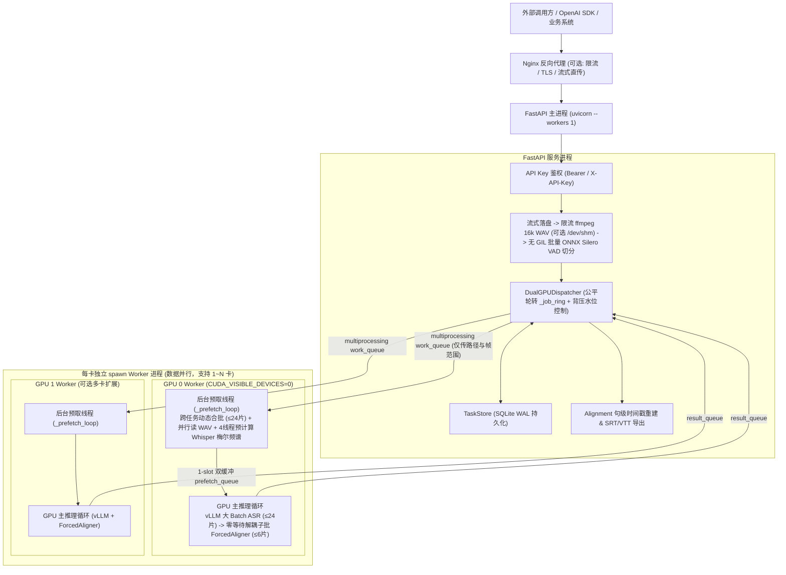

# 系统架构设计

本文档说明 `qwen3-asr-server` 如何围绕 **多卡独立 Worker 数据并行**、**高并发小时级长录音吞吐压榨**、**响度自适应批量 ONNX Silero VAD 无损切分** 以及 **双粒度时间戳重建** 进行架构设计。

---

## 1. 整体架构



---

## 2. 为什么选择“每卡独立 Worker 数据并行”而不是 Tensor Parallelism？

`Qwen3-ASR-1.7B` 参数量仅 1.7B（BF16 权重约 3.4 GB），`Qwen3-ForcedAligner-0.6B` 约 1.2 GB，单张 24 GB（RTX 4090）或 32 GB（RTX 4080 SUPER / 5090）显卡即可同时容纳两个模型并留出充足 KV Cache。

- 若强行使用 `TP=2`：跨 PCIe 卡间 AllReduce 通信开销反而抵消小模型计算收益，且 HuggingFace `ForcedAligner` 无法共享 vLLM 的 TP 切分。
- 采用 **独立 `spawn` 进程数据并行**（按 `GPU_IDS` 动态伸缩，单卡 `0`、双卡 `0,1`、四卡 `0,1,2,3`）：
  - **零跨卡通信开销**：每张卡独立运行完整的 `vLLM + ForcedAligner` 实例；
  - **单段长录音线性加速**：2 小时录音切成约 60 片后，按 `CHUNKS_PER_DISPATCH=6` 拆成 10 个工作单元投入队列，多卡自动并行抢占执行；
  - **多路并发公平调度**：多用户同时提交长录音时，通过公平轮转避免队头阻塞，且每张卡都能跨任务合批吃满算力。

---

## 3. 长录音防 OOM 与无损 Silero VAD 切分链路

处理数小时音视频文件时，如果在主进程将整段 PCM 读入内存或通过 IPC 队列传输音频数组，极易导致内存飙升和序列化瓶颈。本服务采用 **流式落盘 + 路径零拷贝传递 + 局部 Seek 读取**：

1. **流式上传落盘**（`app/audio.py: save_upload_file`）：按 1 MB 分块异步写入 `TEMP_DIR`（默认 `DATA_DIR/tmp_audio`，Linux 大内存环境推荐指向 `/dev/shm/qwen3_asr_tmp` 内存盘），实时校验 `MAX_UPLOAD_SIZE_MB`，超限立即中止并清理。
2. **受控并发转码**（`app/audio.py: decode_to_wav_16k` + `MAX_CONCURRENT_DECODES`）：通过信号量限制并发 `ffmpeg` 进程数（默认 4，每进程 `-threads 2`），将任意音视频格式转为 16kHz 单声道 PCM16 WAV，防高并发上传打满 CPU。
3. **响度自适应 + 无 GIL 批量 ONNX Silero VAD 无损切分**（`app/audio.py: compute_chunks`）：
   - **目标窗口**：按 `CHUNK_TARGET_SEC=120s` 定位名义切分点，前后搜索 `±CHUNK_SEARCH_EXPAND_SEC`（默认 ±15s，即 30s 窗口），数学上严格保证任意切片时长 `≤ target + 2*expand = 150s < 180s`（满足 ForcedAligner 硬上限）。
   - **响度自适应（只用于 VAD 副本）**：`normalize_for_vad` 在切分窗口的临时副本上去除直流偏置并做有界 RMS 归一化（目标 RMS `0.08`，增益限制 `[0.1, 30.0]`，纯静音 `< 1e-5` 不放大），确保极小声（如 -45 dBFS）和极大声录音都能落入 Silero VAD 最佳工作区间，**绝不修改送入 ASR 的原始音频**。
   - **无 GIL 批量 ONNX C++ 推理**：因为相邻候选窗口（如 `[105s, 135s]` 与 `[225s, 255s]`）互不重叠，`_detect_speech_batch_onnx` 将多个窗口打包为连续 NumPy 批量张量 `[M, 512]` 直接送入线程本地（`threading.local()`）的 `onnxruntime.InferenceSession` 执行；完全绕开 PyTorch 逐帧 Python 循环与 GIL 竞争，20 分钟录音切分从 `3.72s` 降至 **`0.90s`**（4.1× 提速），多并发任务在多核上彻底无锁并行。
   - **100% 无损帧连续**：优先落点在语音间隙（≥150ms 非语音停顿）的中央 60% 区域最低能量处，绝不裁切或丢弃任何静音/语音帧；若环境未安装 `silero-vad` 或整窗无停顿，自动回退到低能量谷底算法。
4. **自动清理**：无论同步还是异步任务，均在 `finally` 中删除原始上传文件与临时 16k WAV。

---

## 4. 高并发长录音流水线（调度 + 合批 + 双缓冲预取 + 显存解耦）

面向**多并发小时级长录音**，服务在调度层与 Worker 层做了四层深度协同：

1. **公平轮转调度与背压控制**（`app/dispatcher.py: _pump_scheduler`）：
   - 所有活跃任务注册到环形队列 `_job_ring`，每次仅从每个任务取 1 个小工作单元（`CHUNKS_PER_DISPATCH=6` 片）送入 `work_queue`，在途批次受 `_max_queued_batches` 水位限制。
   - 避免先到达的 3 小时任务把队列塞满导致后到达的 15 分钟任务长时间饿死。
2. **Worker 跨任务动态合批**（`app/worker.py: _prefetch_loop`）：
   - 后台预取线程从 `work_queue` 拉取并合并来自**不同并发任务**的工作单元（单卡支持 `BATCH_COALESCE_WAIT_MS` 聚批窗口），拼满最高 `MAX_INFERENCE_BATCH_SIZE`（如 24 片）的大 Super-Batch。
   - 同一 Super-Batch 内原生支持混合不同的 `language`（含自动检测 `None`）、`context` 热词与 `return_timestamps` 开关，彻底消除零散尾批浪费。
   - 若某个 Super-Batch 因单条异常数据失败，自动降级为按原始 `batch_id` 逐项重试，避免单个坏任务牵连同批正常任务。
3. **双缓冲 WAV 预读 + 后台预计算 Whisper 梅尔频谱**：
   - 当 GPU 主线程在执行第 `N` 批时，预取线程通过 4 线程并行 `read_chunks_from_wav`（单次打开文件批量 Seek）读取第 `N+1` 批波形，并针对 `return_timestamps=true` 的切片提前用 4 线程算好 Whisper 128 维 log-mel 特征（`input_features` + `attention_mask`），放入 `maxsize=1` 的 `prefetch_queue` 实现受控双缓冲。
4. **vLLM 与 ForcedAligner 显存/批大小解耦**：
   - vLLM 自回归解码受显存带宽瓶颈支配，大 Batch（`MAX_INFERENCE_BATCH_SIZE=24`）可大幅提升吞吐；
   - `ForcedAligner` 是全序列 Prefill 前向，单批过大易触发激活显存 OOM。因此将其解耦为独立参数 `ALIGNER_BATCH_SIZE`（默认 `6`），配合 `GPU_MEMORY_UTILIZATION=0.58`（32GB 卡）为对齐留出 ~13 GB 显存空间；
   - 对齐阶段直接复用预取线程算好的 `input_features`（源码确认 `Qwen3ASRForConditionalGeneration.get_audio_features` 严格按 `feature_len` 切片忽略 padding，精度 100% 等价），仅需数毫秒完成文本模板与分词即可送入 GPU，彻底消除 ASR 与 Aligner 之间的梅尔特征计算停顿。

---

## 5. 双粒度时间戳与容错降级机制

`app/alignment.py` 与 `app/worker.py` 协同输出两层时间戳：

1. **字/词级时间戳（`words`）**：由 `Qwen3-ForcedAligner-0.6B` 对切片文本做强制对齐，并叠加该切片的 `start_sec` 偏移量转换为全局时间轴。
2. **句/子句级时间戳（`segments`）**：`build_segments_from_chunk` 将带标点的 ASR 原文与无标点的 `words` 序列做字符级游标匹配：
   - 遇到中英文句末标点（`。！？!?` 以及非小数点场景下的 `.`）切分新句；
   - 遇到较长停顿（默认 `> 1.2s`）或单句过长时在逗号/词边界自然断句，便于直接导出高质量 SRT / WebVTT 字幕；
   - 当 `include_words=true` 时同步输出每句包含的 `words` 子列表。
3. **单片容错降级**：在推理 Worker 内部，仅对非空、含可对齐字符、且属于 ForcedAligner 支持的 11 种语种的切片执行对齐；若单片对齐异常，自动回退为切片起止时间，不影响整段长录音的其它切片。

---

## 6. 性能表现与瓶颈边界（单卡 RTX 4080 SUPER 32GB）

在单张 RTX 4080 SUPER 32GB（16 vCPU、`/dev/shm` 临时目录、开启全量 ForcedAligner 词/句对齐）上的实际表现：

- **真实高密度多并发长录音**（~300 字/分钟真实中文音视频，多任务并发总时长数小时）：GPU 算力与显存带宽稳定跑满（`100%`），显存峰值稳定在 **`~29.5–30.2 GB / 32.8 GB`**（不随并发数增长），实测聚合吞吐约 **`120×–160×` 实时**（1 小时音频约 22–30 秒）。
- **核心优化收益**：相比最初的“全局 VAD 锁 + 8 片固定批 + 同步梅尔提取”基线（显存峰值 `31.5 GB / 32.8 GB` 逼近 OOM、GPU 空窗率 `35.5%`），引入「无 GIL 批量 ONNX Silero VAD + 公平轮转 + 跨任务动态合批 + 后台预取梅尔频谱 + Aligner 批大小解耦」后，显著消除了零散尾批和批间 CPU 空窗，在同等显存安全余量下大幅提升了并发吞吐稳定性。
- **吞吐影响因素**：vLLM 自回归解码耗时与单位时间生成的 Token 密度强相关——语速极快、几乎无停顿的中文内容每分钟输出约 300+ 字，会比语速较慢或静音较多的英文/合成音频慢 1.5–2×。

> **剩余空窗边界说明**：在持续满载并发下，剩余约 ~10% 的稳态空窗主要来自 `vllm.LLM.generate()` 客户端内部的单线程 CPU 音频特征提取。实测尝试通过 `enable_mm_embeds=True` 直传预计算特征以跳过该阶段，但上游 `qwen-asr 0.0.6` 的 `Qwen3ASRProcessor.__call__` 在 `audio=None` 时存在 `StopIteration` 缺陷，故保留稳定官方路径；若需进一步扩展吞吐，直接通过 `GPU_IDS=0,1` 横向加卡即可线性扩展。

---

## 7. 目录结构

```text
.
├── app/
│   ├── __init__.py
│   ├── alignment.py       # 句级时间戳重建、语种合并、SRT/VTT 格式化
│   ├── audio.py           # 流式上传、限流 ffmpeg 转码、响度自适应批量 ONNX Silero VAD、批量按帧读取
│   ├── auth.py            # Bearer / X-API-Key 常量时间比对鉴权
│   ├── config.py          # Pydantic Settings 环境变量配置
│   ├── dispatcher.py      # 多卡 Worker 生命周期、公平轮转调度器、限流转码、Webhook 回调
│   ├── main.py            # FastAPI 路由、SSRF 校验、OpenAI 兼容层
│   ├── schemas.py         # 请求/响应 Pydantic 模型与 verbose_json 转换
│   ├── store.py           # SQLite WAL 任务持久化与过期清理
│   └── worker.py          # 独立进程 GPU Worker（跨任务合批预取、vLLM、零梅尔等待解耦 ForcedAligner）
├── deploy/
│   ├── modal_app.py       # Modal Serverless L4 部署脚本（GPU 显存快照、/cache 持久化、边缘代理鉴权）
│   └── nginx.conf         # 大文件流式上传、限流与 HTTPS 反向代理模板
├── docs/
│   ├── API.md             # 完整 HTTP API 文档
│   ├── ARCHITECTURE.md    # 系统架构与并发优化原理（本文档）
│   └── DEPLOYMENT.md      # 部署、调优与运维手册
├── scripts/
│   ├── download_models.py # ModelScope / HuggingFace 模型权重下载脚本
│   └── test_client.py     # 异步/同步 API 调用与字幕导出示例客户端
├── tests/
│   ├── test_api_integration.py     # 双 Mock Worker 端到端与多语言并发集成测试
│   └── test_audio_and_alignment.py # VAD/能量切分、响度归一化、批量读取、对齐与字幕单测
├── .env.example           # 完整环境变量配置模板
├── .gitignore
├── Dockerfile
├── docker-compose.yml
├── LICENSE
├── pyproject.toml
├── requirements.txt
├── requirements-dev.txt
└── README.md
```
